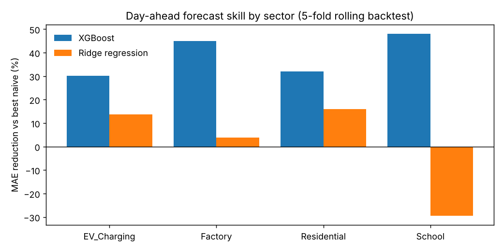
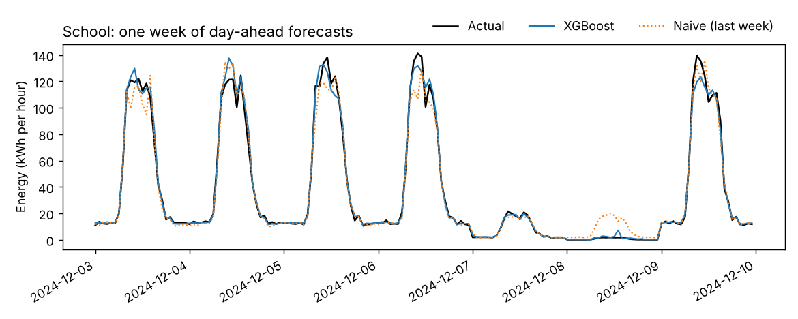

# Energy Forecasting Dashboard

[](https://github.com/mantas123456/energy-forecasting-dashboard/actions/workflows/ci.yml)

Day-ahead forecasting of hourly electricity demand for four building sectors, with a
rolling-origin backtest, two naive baselines and a Streamlit dashboard.

The question this project answers: **if you must forecast tomorrow's hourly demand
today, how much better than "same hour last week" can a model do, and where does it fail?**



## Results

Mean over five 28-day test windows (December back to August). MAE and RMSE are in
kWh per hour. Skill is the reduction in MAE against the better naive baseline in each window.

| Sector | Best model | MAE | Best naive MAE | Skill |
|---|---|---:|---:|---:|
| School | XGBoost | 2.24 | 4.94 | 48% |
| Factory | XGBoost | 15.16 | 31.62 | 45% |
| Residential | XGBoost | 0.10 | 0.15 | 32% |
| EV charging | XGBoost | 3.56 | 5.22 | 30% |

What the numbers show:

- **"Same hour yesterday" is a poor baseline** for any sector with a weekly cycle. It
  forecasts a Monday from a Sunday. "Same hour last week" is much stronger, so every model
  is scored against whichever naive forecast did better.
- **Ridge regression loses to the naive baseline for the school** (−30%). A linear model
  cannot represent the switch between term-day and weekend or holiday load shapes.
  XGBoost can, because it splits on the weekend and holiday flags.
- **Holidays are where the naive forecast breaks.** Holiday hours are 4% of the test
  period but cause 22% of the "last week" baseline's absolute error, because it copies an
  ordinary day into a holiday. For XGBoost, which has the holiday flag, they cause 3%.

Full numbers: [`results/metrics_summary.csv`](results/metrics_summary.csv) and
[`results/metrics_by_fold.csv`](results/metrics_by_fold.csv).



## How it works

1. **Synthetic data** ([`generate.py`](src/energy_forecast/generate.py)). One year of hourly
   demand for residential, school, factory and EV-charging loads. Each sector has its own
   daily load shape, weekend and holiday response, and a heating/cooling response to
   temperature around 21 °C, using a Malta-like climate and Maltese public holidays.
   Emissions use an hour-of-day grid factor (300–450 g CO2e/kWh). Spikes, dropouts and level
   shifts are injected and labelled, so they can also be used for anomaly detection.
2. **Leak-free features** ([`features.py`](src/energy_forecast/features.py)). Lags at 24, 48 and
   168 hours; 24-hour and 168-hour rolling means; cyclical hour, weekday and season
   encodings; weekend and holiday flags; temperature. Everything built from the target is
   shifted by the full 24-hour horizon and computed per sector.
3. **Rolling-origin backtest** ([`evaluate.py`](src/energy_forecast/evaluate.py)). For each
   28-day window, models train only on data before it, as they would in production.
4. **Models** ([`models.py`](src/energy_forecast/models.py)). Naive (yesterday), naive (last
   week), ridge regression, XGBoost.

## Limitations

- The data is synthetic, so the absolute errors say nothing about real buildings. The
  method (baselines, leak-free features, rolling backtest) carries over.
- Temperature at the target hour is taken from the simulation, which stands in for a
  perfect weather forecast. Real day-ahead weather forecasts would add error.
- Injected anomalies stay in the test windows. Nothing can predict them, so they put a floor
  under the error.

## Run it

```bash
git clone https://github.com/mantas123456/energy-forecasting-dashboard
cd energy-forecasting-dashboard
pip install -e ".[app,dev]"

energy-forecast --out results     # generate data, backtest, write results (about 15 s)
streamlit run app/dashboard.py    # explore results, or upload your own hourly CSV
pytest                            # tests, including checks that no feature leaks the future
```

Settings such as sectors, horizon, number of folds and XGBoost parameters are in
[`config/config.yaml`](config/config.yaml). `requirements.txt` pins the exact versions that
produced the committed results.

## Project layout

```
config/config.yaml        all settings
src/energy_forecast/      generate, features, models, evaluate, pipeline
app/dashboard.py          Streamlit dashboard
tests/                    pytest suite (leakage, splits, metrics, reproducibility)
results/                  metrics, predictions and plots from the last run
```

## Changes in v3

v2 computed rolling averages that included the hour being predicted, which leaked the
answer into the features and made the reported errors look better than they were. v3
rebuilds the pipeline with horizon-aware lags, per-sector features, real multi-sector data,
naive baselines and a rolling backtest, and adds tests that would catch the leak.

---
Mantas Valantinavičius · [github.com/mantas123456](https://github.com/mantas123456)
